# ProgesApp 6 — gratis

Presupuestos, clientes, almacén y cobros para autónomos instaladores. Gratis, sin cuentas y
sin internet: todo vive en tu teléfono.

Hecha por [Domiatek](https://domiatek.com) · [Página de ProgesApp](https://domiatek.com/progesapp)

## Por qué existe

En Domiatek somos autónomos, como tú. Hemos hecho ProgesApp para que los autónomos trabajemos
mejor, nos pasemos trabajo entre nosotros y crezcamos juntos.

**La edición gratis es para empezar, y es gratis para siempre**: sin anuncios, sin cuentas y
sin fecha de caducidad.

Cuando tu negocio crezca, tienes **ProgesApp Pro**, más completa y con más
herramientas. **Se paga una sola vez y es tuya**, con todas las mejoras de su versión incluidas.

Más adelante podrá haber suscripciones **opcionales** para servicios extra, como la copia en la
nube. Las decidiremos con lo que nos pidáis: escríbenos a info@domiatek.com. Nunca serán
obligatorias, y lo que ya tienes no dejará de funcionar.

— Domiatek

  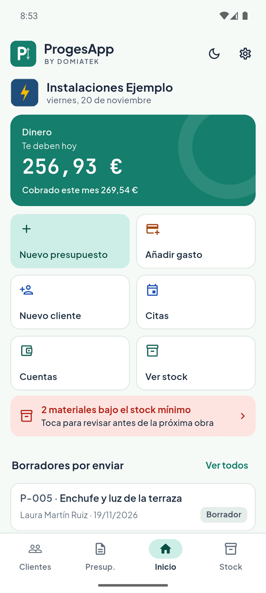
  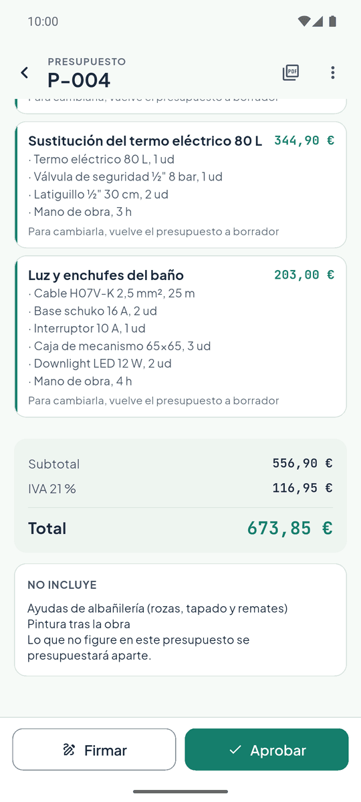
  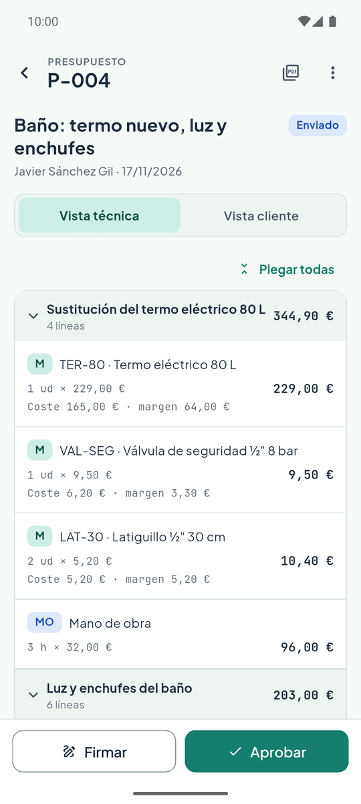
  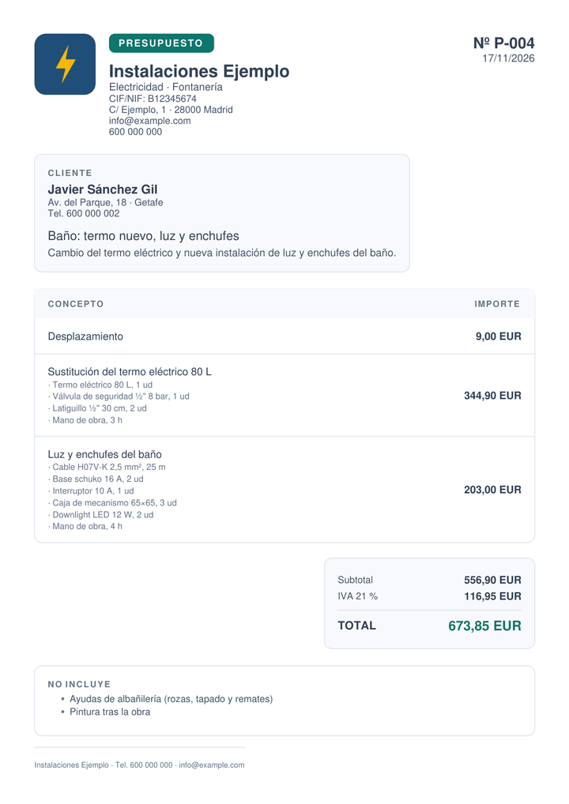
  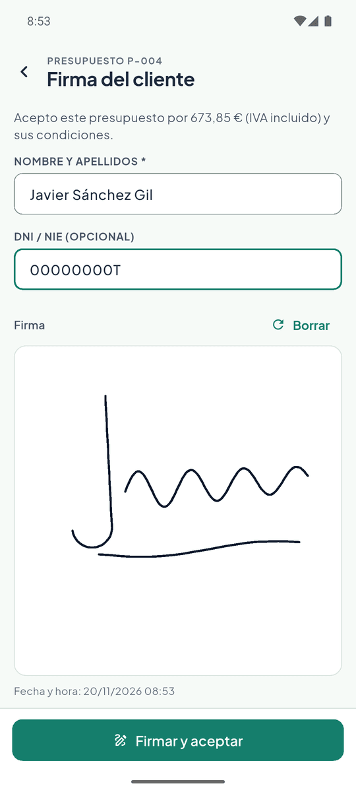

## Descargar

**[Descargar ProgesApp 6.2.9 (APK)](https://github.com/Domiatek/progesapp-descargas/releases/latest/download/ProgesApp.apk)** ·
[Manual de uso (PDF)](https://github.com/Domiatek/progesapp-descargas/releases/latest/download/ProgesApp-Manual-de-uso.pdf)

1. Descarga el archivo desde el móvil. Android avisará de que no viene de la tienda: pulsa
   *Descargar igualmente*.
2. Ábrelo. Si dice que no puede instalar aplicaciones de origen desconocido, entra en
   *Configuración* y activa *Permitir de esta fuente*. Ese permiso es para el navegador, no
   para ProgesApp, y puedes quitarlo después.
3. Pulsa *Instalar*.

## Qué hace

**Presupuestos**
- Vista técnica (coste y margen de cada línea) y vista de cliente (por partidas), en PDF con tu
  logo, listos para mandar por WhatsApp.
- Descuento en %, «Absorber el IVA» y «Dejar el total en…».
- Dos trabajos predefinidos por oficio, que puedes ajustar a tus precios, con cálculo por medida.
- Validez, duplicar, modificados que aprueba el cliente con historial de versiones.
- El cliente firma con el dedo en tu móvil, con nombre, DNI, fecha y hora.
- Lista por cliente o por fecha.

**Trabajos por horas**
- Para averías y chapuzas sin presupuesto: horas y material de cada día, parte valorado y
  firma del cliente.

**Clientes, almacén y cobros**
- Clientes con buscador y archivo de los antiguos.
- Almacén con stock, mínimos, coste y venta; mano de obra y desplazamiento.
- Anticipo al aceptar y pagos por avance; lo que te deben, en la pantalla de inicio.
- Citas en el calendario del teléfono.
- Gastos con su ticket (foto o PDF) y cuentas del trimestre con el IVA.

**Trabajar con otros**
- Pásale a un compañero tu material o una partida por WhatsApp o correo, y añade las suyas a
  tu presupuesto.

**Tus datos**
- Copia de seguridad que exportas e importas tú, también para cambiar de móvil. Si llevas 30
  días sin hacerla, la app te lo recuerda.
- Modo claro y oscuro.

  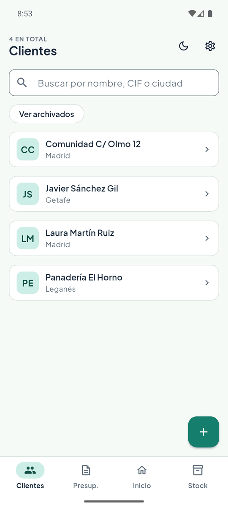
  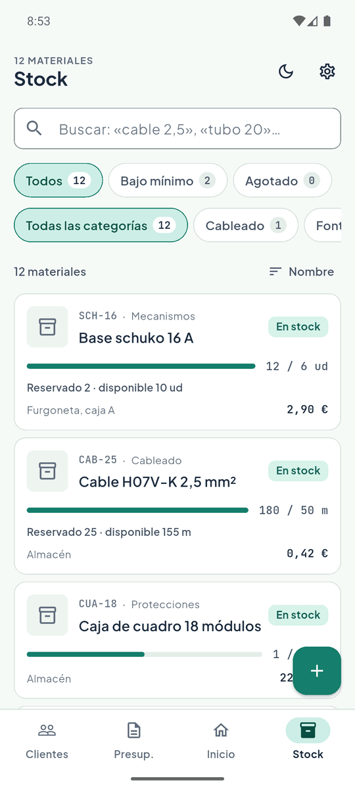
  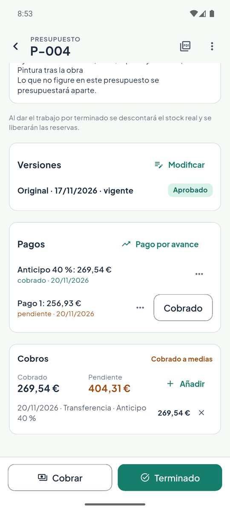
  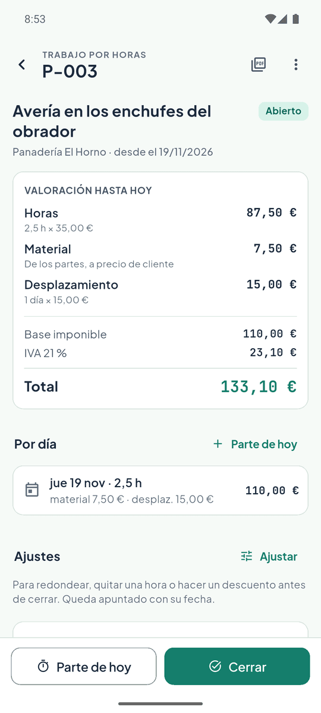
  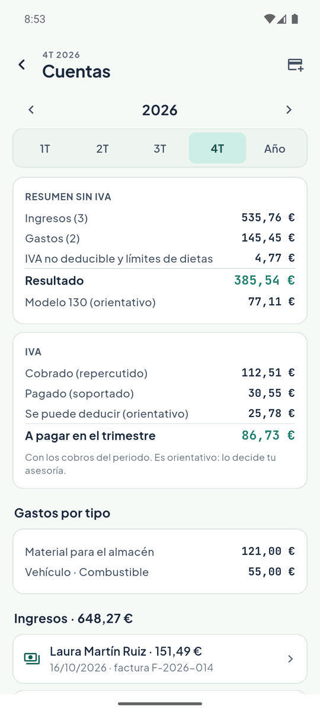
  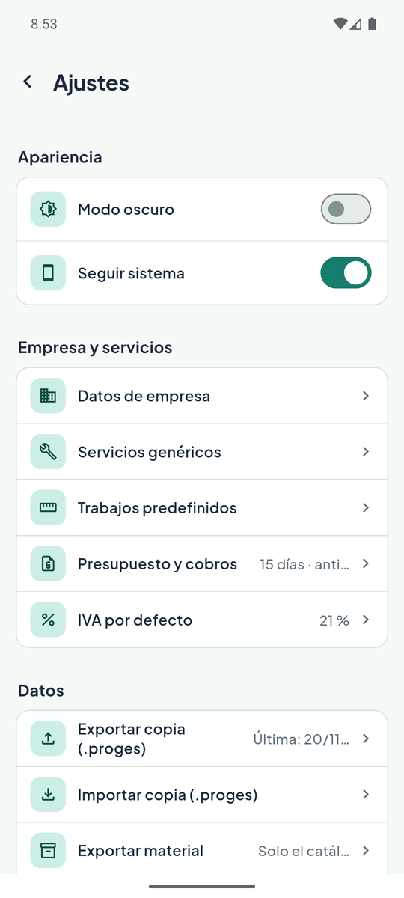
  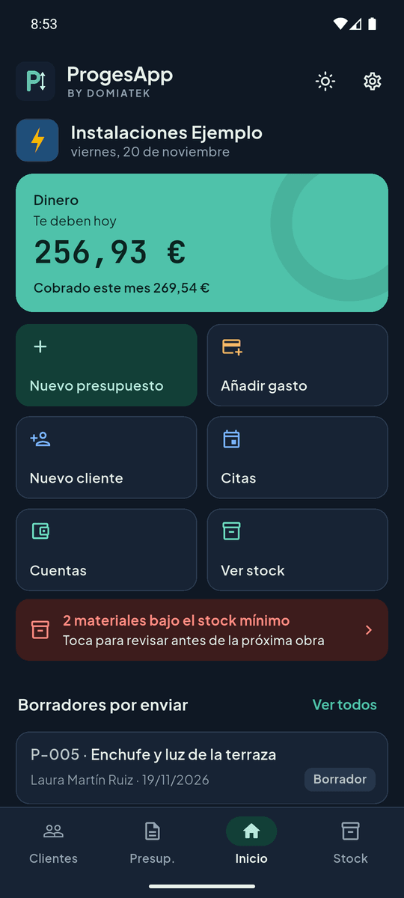

## Lo que tiene la edición gratis

Pensada para que un instalador con poco volumen trabaje con ella de verdad:

- 2 presupuestos en borrador y 1 enviado o aprobado a la vez, más 1 trabajo por horas en
  marcha. Los rechazados y terminados no cuentan: el historial es ilimitado.
- 2 trabajos predefinidos por oficio.

## ProgesApp Pro

ProgesApp Pro, de pago único, llegará aparte con el catálogo completo de trabajos por oficio, las
herramientas de cálculo (estancias con huecos, pintura, hormigón, caída de tensión, fotos con
cotas…), la lectura automática de tickets, la gestión de obra (partes, fichar, margen real),
los mantenimientos, la pantalla Dinero y el envío a la asesoría. Todo lo que hagas con la 6 se
conserva al pasar a Pro.

## Qué no hace

**No emite facturas.** Desde 2027 un programa que expida facturas debe cumplir el
RD 1007/2023 (Verifactu). Prepara aquí el presupuesto, factura con tu programa y anota el cobro.

**No sincroniza ni hace copias solas.** Los datos están solo en tu teléfono.

## Privacidad

Solo pide un permiso, el del calendario, y únicamente si usas las citas. No hace ninguna
conexión a internet: ni para mostrarse ni para generar los PDF. Sin cuentas, sin analítica, sin
publicidad y sin identificadores. Nosotros no tenemos acceso a lo que guardes y no podemos
recuperarlo si lo pierdes.

## Contacto

- Correo: [info@domiatek.com](mailto:info@domiatek.com)
- Toda la información de la app: [domiatek.com/progesapp](https://domiatek.com/progesapp)
- Domiatek: [domiatek.com](https://domiatek.com)

---

Este repositorio solo aloja las descargas; el código no es público.
© 2026 Domiatek. Gratuita y sin garantía.
